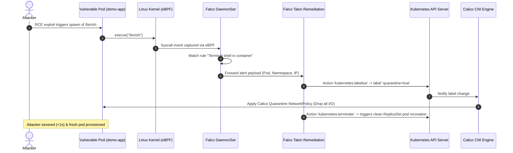

# Formal Threat Model & Mitigation Map

## 1. Scope & Objective
This document defines the threat vectors, attacker techniques (mapped against MITRE ATT&CK for Containers), and platform-native defensive mitigations implemented across the platform.

---

## 2. Threat Matrix & Mitigation Mapping

| Threat ID | Threat / Attack Vector | MITRE ATT&CK Technique | Primary Platform Mitigation | Detection & Response Mechanism |
| :--- | :--- | :--- | :--- | :--- |
| **TH-01** | IaC misconfiguration / Public cloud resource leak | T1580 (Cloud Infrastructure Discovery) | Pre-commit & CI validation with Checkov | GitHub Actions blocks pull requests failing CIS benchmarks |
| **TH-02** | Vulnerable container dependencies / base images | T1190 (Exploit Public-Facing Application) | Trivy filesystem & image vulnerability scanner in CI | Critical/High CVE gating before deployment |
| **TH-03** | Lateral movement between tenant pods | T1210 (Exploitation of Remote Services) | Calico GlobalNetworkPolicy (Default Deny Ingress/Egress) | Calico flow logs + Prometheus network metric alerts |
| **TH-04** | Container escape / Kernel privilege escalation | T1611 (Escape to Host) | Bottlerocket OS + ReadOnlyRootFilesystem + Non-root execution | Falco eBPF syscall monitoring (Privileged container check) |
| **TH-05** | Interactive shell spawn in production container | T1059.004 (Unix Shell Execution) | Minimal scratch/distroless base images; seccomp profile | Falco rule `Terminal shell in container` |
| **TH-06** | Compromised pod exfiltrating data to external C2 | T1071 (Application Layer Protocol) | Calico Egress domain filtering & strict CIDR white-listing | Falco outbound network rule + Falco Talon dynamic quarantine label |
| **TH-07** | Pod credential abuse against Cloud API | T1078 (Valid Accounts) | Cloud Workload Identity (GCP) & IRSA (AWS); IMDSv2 Hop-limit 1 | CloudTrail / GCP Audit Logs monitoring credential usage |

---

## 3. Incident Lifecycle: Interactive Breach to Active Remediation

---

## 4. Verification & Audit Procedures
Automated verification is conducted via the [verify-remediation.sh](file:///Users/mest/dev/cloud-workload-modernization-platform/scripts/verify-remediation.sh) test script, simulating an unauthorized shell invocation in a sandbox namespace and validating that Falco alerts and Talon quarantine policies engage as expected.
